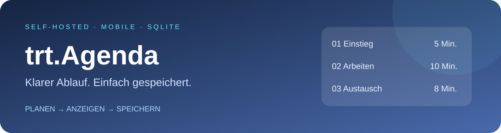
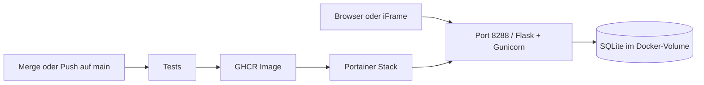

# 🗓️ trt.Agenda



[](https://github.com/jbkunama1/trt.Agenda/actions)


Eine kleine, selbst gehostete Agenda für Unterricht, Besprechungen und Workshops. Startzeit festlegen, Minuten je Punkt eintragen und die Agenda als iFrame anzeigen. HTML/CSS/JavaScript im Browser, Flask und SQLite auf deinem Server.

[🌐 Projektseite nach Pages-Aktivierung](https://jbkunama1.github.io/trt.Agenda/) · [🐳 Compose-Datei](docker-compose.yml) · [⚙️ Build-Status](https://github.com/jbkunama1/trt.Agenda/actions)

## ✨ Funktionen

| Funktion | Umsetzung |
|---|---|
| Mobile Ansicht | Blauer Gradient, responsive Karten |
| Zeitplanung | Eine globale Startzeit, berechnete Zeitbereiche |
| Dauer | Ganze Minuten von 1 bis 1440 pro Punkt |
| Punkte | Hinzufügen, löschen, nach oben/unten verschieben; maximal 50 |
| Speicherung | Explizit mit Speichern, dauerhaft in serverseitiger SQLite |
| Bearbeiten | Gemeinsamer Bearbeitungsschlüssel über EDIT_PASSWORD |
| Einbetten | ?embed=1 ohne Bearbeitungsbutton und Fußzeile |
| Aktualisierung | Anzeige lädt alle 15 Sekunden neu; nicht während der Bearbeitung |
| Konfliktschutz | Versionsprüfung verhindert unbemerktes Überschreiben |

Eine gemeinsame Agenda, keine Konten, keine Kalendertermine, keine individuellen Startzeiten je Punkt, kein Countdown. Fünf Beispielpunkte werden nur beim ersten Datenbankaufbau angelegt.

## 🧩 Architektur



## 🚀 Installation mit Portainer

1. In GitHub Actions den letzten erfolgreichen Lauf von test-and-docker prüfen. Das Image muss bereits gebaut sein.
2. GHCR-Paket trt.agenda für anonymen Pull auf Public setzen oder GHCR-Zugang in Portainer hinterlegen. Repository-Sichtbarkeit ist nicht gleich Paket-Sichtbarkeit.
3. Prüfen, dass Port 8288 frei ist und das externe Docker-Netzwerk highfishNetwork existiert. Nur falls es fehlt und ein Bridge-Netzwerk gewünscht ist: auf dem Docker-Host `docker network create highfishNetwork`.
4. In Portainer Stacks → Add stack → Repository wählen.
5. Repository URL: `https://github.com/jbkunama1/trt.Agenda`; Reference: `refs/heads/main`; Compose path: `docker-compose.yml`. Alternativ die Compose-Datei in den Web-Editor kopieren.
6. Stack-Umgebungsvariable EDIT_PASSWORD auf einen langen zufälligen Schlüssel setzen. Optional FRAME_ANCESTORS einschränken.
7. Deploy the stack. Die Compose-Datei zieht das fertige GHCR-Image, kein lokaler Build.
8. `http://SERVER-IP:8288` öffnen.

## 🐳 Installation mit Docker Compose

Voraussetzungen: Docker Engine, Compose v2 und Git; aktuelles Image für die passende Host-Architektur. Der bestehende Workflow erstellt kein Multiarch-Image. ARM-Unterstützung ist nicht zugesichert.

```bash
git clone https://github.com/jbkunama1/trt.Agenda.git
cd trt.Agenda
cp .env.example .env
joe .env
# EDIT_PASSWORD durch einen langen zufälligen Schlüssel ersetzen!
docker network inspect highfishNetwork
# Nur wenn nicht vorhanden und Bridge-Netzwerk gewünscht:
# docker network create highfishNetwork
docker compose pull
docker compose up -d
docker compose ps
```

Bei privatem GHCR-Paket vorher `docker login ghcr.io` mit geeignetem GitHub-Token oder Registry-Zugang in Portainer konfigurieren. Niemals echte Tokens oder Passwörter committen.

## ⚙️ Konfiguration

| Variable / Wert | Bedeutung | Standard |
|---|---|---|
| EDIT_PASSWORD | Gemeinsamer Schlüssel für Schreibzugriff; erforderlich | Kein Standard |
| FRAME_ANCESTORS | Erlaubte Elternseiten für iFrames | * |
| DATABASE | SQLite-Datei im Container | /data/agenda.sqlite3 |
| Port | Host → Container | 8288 → 8000 |
| Netzwerk | Externes Docker-Netzwerk | highfishNetwork |
| Volume | Datenablage, häufig mit Stack-Präfix | agenda_data |

Beispiel `.env`:

```dotenv
EDIT_PASSWORD=HIER_EINEN_LANGEN_ZUFAELLIGEN_SCHLUESSEL_SETZEN
FRAME_ANCESTORS='self' https://unterricht.example.de
```

## 📝 Bedienung und iFrame

Normale URL öffnen → Bearbeiten → Schlüssel eingeben → Titel, Startzeit und Punkte ändern → Speichern. Nicht gespeicherte Änderungen gehen beim Verlassen verloren. Bei Versionskonflikt Änderungen kopieren, Abbrechen wählen und neu eintragen.

```html
<iframe
  src="https://agenda.example.de/?embed=1"
  title="Agenda"
  style="width:100%;height:640px;border:0;border-radius:18px;"
  loading="lazy">
</iframe>
```

Die Breite ist responsiv; die Höhe legt die Elternseite fest. Lange Agenden scrollen. Tageswechsel werden als +1 Tag usw. angezeigt. HTTPS-Elternseite mit HTTPS-Agenda einbetten. Reverse Proxy darf keine widersprechenden X-Frame-Options/CSP-Header senden; die Elternseite muss die Agenda als frame-src erlauben.

## 🔄 Updates

```bash
git pull
docker compose pull
docker compose up -d
```

In Portainer Stack aktualisieren und neues Image ziehen. Der Build aktualisiert laufende Container nicht automatisch. Änderungen an Umgebungsvariablen benötigen eine Container-Neuerstellung. Für reproduzierbare Deployments kann statt latest ein vorhandenes SHA-Tag in der Compose-Datei verwendet werden.

## 💾 Backup und Wiederherstellung

Das Volume erhält Daten bei Container-Neuerstellung. Nicht `docker compose down -v` ausführen, wenn Daten erhalten bleiben sollen.

Konsistente Sicherung auf dem Docker-Host, aus dem Projektordner:

```bash
mkdir -p backups
docker compose stop agenda
docker cp trt-agenda:/data/agenda.sqlite3 ./backups/agenda.sqlite3
docker compose start agenda
```

Bei fehlgeschlagenem Kopieren den Container ebenfalls wieder starten. Backup außerhalb des Servers sichern; die Datei wird beim nächsten Backup überschrieben, daher datierte Kopien aufbewahren. Wiederherstellung überschreibt die aktuelle Agenda: Container stoppen, gesicherte Datei per `docker cp ./backups/agenda.sqlite3 trt-agenda:/data/agenda.sqlite3` zurückkopieren, Schreibrechte für UID 10001 sicherstellen und Container starten. Volume-Backups über deine bestehende Backup-Lösung sind ebenfalls möglich; für einfache Dateikopien vorher Schreibzugriffe stoppen.

## 🔐 Sicherheit und Grenzen

- Inhalte sind öffentlich lesbar, sobald die URL erreichbar ist. Kein Leseschutz und keine vertraulichen Schülerdaten.
- Schreibzugriff verlangt den gemeinsamen Schlüssel. Keine Benutzerverwaltung, keine 2FA, keine eingebaute Login-Drosselung.
- Schlüssel wird nicht in URL oder Browser-Speicher abgelegt; Übertragung nur über HTTPS im Internet.
- TLS über Reverse Proxy bereitstellen. Direkten Portzugriff per Firewall entsprechend begrenzen.
- Container läuft als Nicht-Root-Benutzer. Regelmäßige Updates und Backups einplanen.
- Shields-Badges in Dokumentation laden externe Bilder; die eigentliche Agenda benötigt keine CDNs.

## 🛠️ Fehlersuche

| Problem | Prüfen / Lösung |
|---|---|
| Image pull denied / not found | Actions-Erfolg, korrekter Image-Name, Paket-Sichtbarkeit und Registry-Zugang |
| Network not found | highfishNetwork auf dem Ziel-Docker-Host prüfen |
| Port already allocated | Port 8288 freigeben oder Host-Port anpassen |
| Container startet nicht | EDIT_PASSWORD gesetzt? `docker logs trt-agenda` prüfen |
| SQLite nicht beschreibbar | Volume-Rechte für UID 10001; insbesondere bei eigenen Bind-Mounts |
| iFrame bleibt leer | HTTPS, FRAME_ANCESTORS, Proxy-Header und CSP der Elternseite |
| Speichern abgewiesen | Schlüssel, gültige Titel und Dauern prüfen; bei Konflikt neu laden |
| Daten verschwunden | Richtiger Stack und gleiches Volume? Volume gelöscht oder Stack-Namen geändert? |

## 🧪 Entwicklung, API und CI

```bash
python -m venv .venv
. .venv/bin/activate
pip install -r requirements.txt -r requirements-dev.txt
python -m pytest -q
export EDIT_PASSWORD='dein-langer-schluessel'
export DATABASE='./data/agenda.sqlite3'
gunicorn --bind 0.0.0.0:8288 --workers 1 --threads 4 app:app
```

Lokaler Docker-Build: `docker build -t trt-agenda .`; die normale Deployment-Compose bleibt absichtlich auf GHCR eingestellt.

| Route | Zweck |
|---|---|
| GET / | Agenda-Oberfläche |
| GET /api/agenda | Agenda und Version lesen |
| PUT /api/agenda | JSON mit data und version speichern; Header X-Edit-Key erforderlich |
| GET /health | Einfacher HTTP-Liveness-Check, kein vollständiger Datenbanktest |

CI: Tests bei Pull Requests und Push auf main. Nach erfolgreichen Tests Build/Push nach GHCR bei Push auf main (inklusive Merge) und workflow_dispatch. Tags latest und SHA, GHA-Buildcache. Auch Dokumentations-Commits lösen den bestehenden Workflow aus. Build-Erfolg, Paket-Sichtbarkeit und Live-Deployment sind hier nicht als geprüft zugesichert; aktuellen Actions-Status ansehen.

## 🌐 GitHub Pages

`index.html` im Hauptverzeichnis ist eine statische Projekt- und Installationsseite mit illustrativer Agenda-Vorschau. Sie betreibt kein Flask und keine SQLite-Datenbank.

Aktivieren: Repository → Settings → Pages → Source: Deploy from a branch → Branch: main → Folder: / (root) → Save. Nach erfolgreicher Pages-Veröffentlichung ist die erwartete Adresse `https://jbkunama1.github.io/trt.Agenda/`. Die Veröffentlichung ist nicht automatisch bestätigt.

## 📁 Dateien

| Pfad | Inhalt |
|---|---|
| app.py, templates/, static/ | Laufende Webapp |
| Dockerfile, docker-compose.yml | Image-Build und GHCR-Deployment |
| tests/, .github/workflows/docker.yml | API-Tests und Container-CI |
| index.html, docs/assets/banner.svg, .nojekyll | Statische Projektseite und Grafik |
| .env.example | Konfigurationsvorlage ohne echte Geheimnisse |

## ⚖️ Lizenz

Aktuell ist keine LICENSE-Datei enthalten. Eine Open-Source-Lizenz wird daher nicht behauptet.
